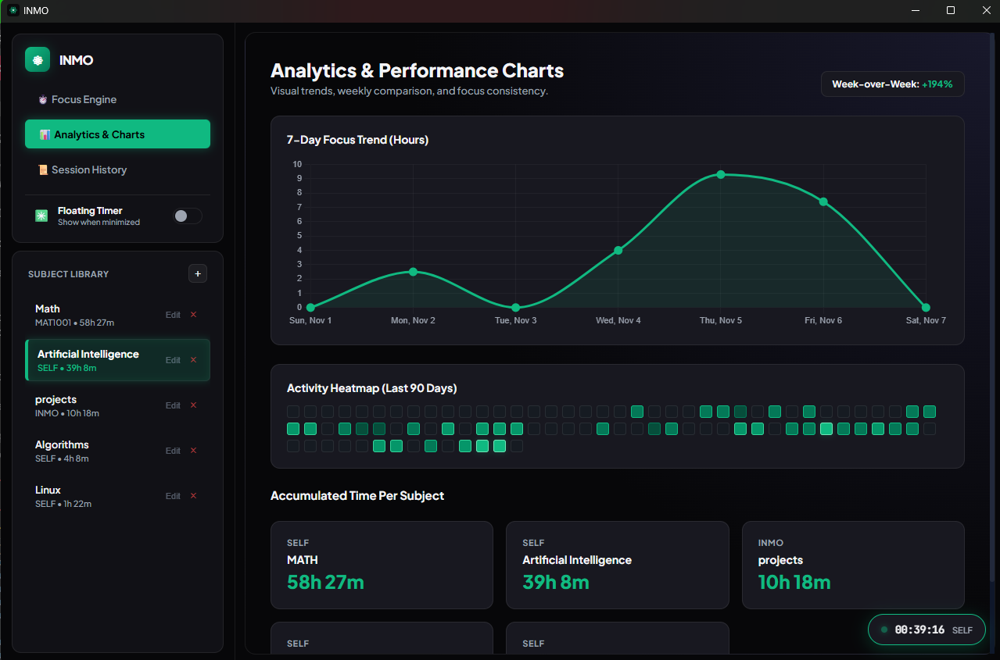

# inmo

A desktop study tracker for university courses. Time your study sessions per subject, keep a to-do list for each one, and see where your hours actually go. All your data stays on your machine.

[](https://github.com/rrr090/inmo/releases/latest)




## Features

- **Focus timer:** a stopwatch, or Pomodoros with automatic short and long breaks (lengths are up to you, and the next Pomodoro can start by itself after a break), logged against the subject you pick. The clock runs in the app's backend, so it keeps exact time while the window is minimized.
- **Away detection:** if the stopwatch runs with no keyboard or mouse activity for a while (10 minutes by default), inmo asks when you're back whether to keep that time.
- **Tray and shortcut:** start or stop the timer from the tray icon or with Ctrl+Alt+S from any app. inmo can start with Windows, and the close button can send it to the tray instead of quitting.
- **Subjects and tasks:** add, edit and archive courses, each with its own to-do list. Archived subjects keep their history and still count in analytics.
- **Analytics:** a 7/30/90-day focus trend (total or split by subject) with daily average, goal and previous-period lines, summary stats, week-over-week comparison, a 90-day activity heatmap, each subject's share of your time, weekday averages and a weekday × hour grid of when you study.
- **Goals and streaks:** a daily target (2 hours unless you change it), optional weekly goals per subject, a running study streak and your longest streak ever.
- **Session history:** every session, newest first. Add time you studied without the timer, edit or delete any session, and export or import CSV.
- **Notifications:** Windows notifications when a Pomodoro or break ends, when you're back after being away, and when a session is saved, each of which can be turned off, plus an optional chime at the end of a Pomodoro or break.
- **Floating timer:** an optional always-on-top widget that appears when you minimize the app or close it to the tray, so you can see or stop the timer from anywhere.
- **Crash recovery:** a running session is saved as soon as it starts, so a crash or power cut doesn't lose your time. Closing inmo saves it normally.
- **Backups:** a weekly copy of your data (the newest 8 are kept), a "Back up now" button, and restore from any backup in Settings.
- **Auto-updates:** new versions download in the background and install when you close inmo. Settings also has "Check now".
- **One window:** opening inmo while it's already running brings the existing window forward instead of starting a second copy.

## Install

Download the latest `inmo_<version>_x64-setup.exe` from [Releases](https://github.com/rrr090/inmo/releases/latest) and run it. Windows is the only platform with a packaged build.

### Upgrading from 1.1 or earlier

Auto-updates start with 1.2, so 1.1 and earlier need one manual install: close inmo and run the latest installer. It replaces 1.1 in place and keeps your data. From then on, updates arrive by themselves.

### Upgrading from 1.0.x (Electron)

Versions up to 1.0.5 were built with Electron and won't update themselves to 1.1. To upgrade:

1. Close inmo.
2. Install the latest `inmo_<version>_x64-setup.exe`.
3. Uninstall the old version from **Settings → Apps → Installed apps** (the entry named `inmo` with version 1.0.x).
4. If the `inmo` shortcut disappeared from the desktop or Start menu, run the new installer again to restore it. The old uninstaller removes shortcuts with that name.

Your subjects, sessions and tasks carry over automatically. The Tauri version reads the same database file, and the first time it opens it, it saves a copy to `%APPDATA%\inmo\backups\academic_steam_spotify-before-tauri.db`. To go back, close inmo and copy that file over `%APPDATA%\inmo\academic_steam_spotify.db`.

## Why inmo moved from Electron to Tauri

Up to 1.0.5, inmo was an Electron app. Electron bundles a full copy of Chromium and Node.js with every app, which is a lot of weight for a study timer. In 1.1 the backend was rewritten in Rust on [Tauri](https://tauri.app), which renders the same interface with the WebView2 engine that already ships with Windows.

| | 1.0.5 (Electron) | 1.1.0 (Tauri) |
|---|---|---|
| Installer | 107 MB | 2.3 MB |
| Installed size | 378 MB | 5.4 MB |
| Backend | Node.js + `sqlite3` native module | Rust + `rusqlite` |

The interface and your data didn't change in the move: the database is the same SQLite file in the same place. Since 1.2 the Tauri version also has everything the Electron one did, including auto-updates.

## Run from source

Requires [Node.js](https://nodejs.org) and [Rust](https://www.rust-lang.org/tools/install). WebView2 is already part of Windows 10 and 11.

```bash
git clone https://github.com/rrr090/inmo.git
cd inmo
npm install
npm start
```

Rust unit tests cover the timer, Pomodoro cycles, away detection, crash recovery, manual sessions, CSV import/export and backup restore:

```bash
node build-ui.js   # once: the Rust build embeds its output, tauri-ui-dist/
cargo test --manifest-path src-tauri/Cargo.toml
```

To build the Windows installer into `src-tauri/target/release/bundle/nsis/`, set the update-signing key first (see Releasing):

```bash
npm run build
```

## Releasing

Updates are signed, and installed copies only accept updates signed with the key whose public half is in `src-tauri/tauri.conf.json`. Keep the private key (`~/.tauri/inmo.key`) backed up: without it, existing installs can't be updated.

1. Bump the version in `package.json`, `src-tauri/Cargo.toml` and `src-tauri/tauri.conf.json`.
2. Push a tag: `git tag v1.2.0 && git push origin v1.2.0`.
3. The **Release** workflow tests, builds and signs the installer, and attaches it and `latest.json` to a draft release. It needs the repository secret `TAURI_SIGNING_PRIVATE_KEY` (the contents of the key file).
4. Edit the draft's notes and publish it. Installed copies pick it up within six hours, or at their next launch.

To build a signed installer locally instead, set `TAURI_SIGNING_PRIVATE_KEY` to the key file's path and `TAURI_SIGNING_PRIVATE_KEY_PASSWORD` to an empty string before `npm run build`.

## How it works

| Part | File | Role |
|---|---|---|
| App setup | `src-tauri/src/lib.rs` | Starts everything, the floating timer window, quitting |
| Database | `src-tauri/src/db.rs` | Schema and migrations, settings, automatic backups |
| Timer | `src-tauri/src/timer.rs` | The clock, Pomodoro breaks, away detection, crash recovery |
| Commands | `src-tauri/src/commands.rs` | Subjects, sessions, tasks and settings for the interface |
| Import/export | `src-tauri/src/data_io.rs` | CSV export and import, backup and restore |
| Tray, updates | `src-tauri/src/tray.rs`, `updater.rs`, `idle.rs` | Tray icon, global shortcut, start with Windows, auto-updates, idle time |
| API bridge | `src/tauri-api.js` | Exposes `window.api`, where each method invokes one Rust command |
| Interface | `src/index.html`, `src/app.js` and one module per page | Timer, subjects, tasks, analytics, history, settings |
| Floating timer | `src/mini-widget.html`, `src/tauri-mini.js` | Always-on-top widget fed by the backend timer |
| Frontend build | `build-ui.js` | Copies `src/` and the libraries it loads from `node_modules` into `tauri-ui-dist/` for bundling |

The interface never touches the database directly. It reaches it only through the commands registered in `lib.rs`, and a content security policy stops the page from loading anything from the internet.

**Crash recovery:** when a session starts, its start time goes into a single-row `active_session` table, and the row is cleared when the session ends. A running session also records a heartbeat every 30 seconds. If a row is still there at the next launch, the app credits the time up to the last heartbeat to that subject, so time spent with the app closed doesn't count. Pomodoro sessions are capped at the Pomodoro length, and anything under 30 seconds or over 12 hours is discarded as unreliable.

**Single instance:** only one copy of inmo runs at a time. A second launch focuses the running window and exits before it opens the database, so two copies can never write the same session.

## Data and privacy

Your study data lives in `%APPDATA%\inmo\academic_steam_spotify.db`, a local SQLite file. Weekly backups go to `%APPDATA%\inmo\backups\`. There are no accounts, and your data is never uploaded. The only network request is the update check against GitHub Releases.
